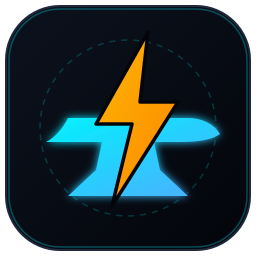
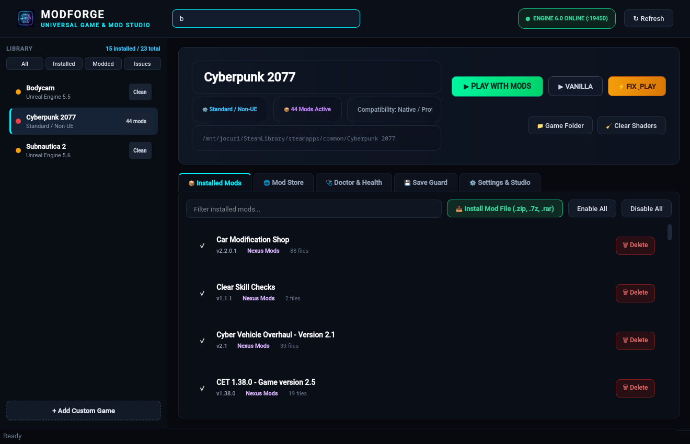

<p align="center">
  
</p>

<h1 align="center">ModForge — Universal Game & Mod Studio</h1>

<p align="center">
  <strong>The ultimate high-performance, native mod manager and crash-hunting studio for Linux, Steam Deck, and PC.</strong>
</p>

<p align="center">
  <a href="https://github.com/pigeoonn/modforge/releases"></a>
  <a href="LICENSE"></a>
  <a href="#"></a>
  <a href="#"></a>
</p>

---

<p align="center">
  
</p>

---

## ⚡ What is ModForge?

**ModForge** is a next-generation game modding studio designed for players and modders who want speed, reliability, and precision. Unlike sluggish browser-wrapped or Electron managers, ModForge combines a **lightning-fast Rust backend engine** with a **sleek, responsive native desktop interface**.

Your original game files are sacred. ModForge employs a non-destructive library system: mods are hard-linked into the game directory with journaled history, so clicking **"Vanilla"** immediately restores your clean game files in milliseconds.

---

## 🚀 Key Features

### 🖥️ Native Cyberpunk Studio Interface
- Zero browser overhead, zero Electron bloat, instant startup in under 150ms.
- High-contrast, dark obsidian theme with fluid responsive layout.
- Real-time engine status telemetry and smooth multi-threaded responsiveness.

### 🌐 Universal 3-Store Browser
- Browse, search, and 1-click install mods directly from:
  - 🟣 **Nexus Mods** (Full API integration & 1-click `nxm://` protocol handling)
  - ⚡ **Mod Store** (Thunderstore community mod catalog)
  - 🟢 **mod.io** (Cross-platform and indie game repository)
  - 📦 **Local Archives** (Drag and drop `.zip`, `.7z`, or `.rar` packages directly into the window)

### 🩺 Doctor Diagnostics & Crash Detective
- Automatic log parsing for **REDscript**, **UE4SS**, **BepInEx**, and **MelonLoader**.
- **Missing Framework Detector**: Instantly alerts you if a mod depends on missing core libraries (e.g., ArchiveXL, RED4ext, TweakXL, Cyber Engine Tweaks).
- **Duplicate & Clash Resolver**: Identifies duplicate framework installations and conflicting file overwrites.
- **1-Click Auto-Repair / Self-Heal**: Automatically cleans broken hooks, restores missing frameworks, and aligns runtime versions.

### 💾 Save Guard
- Automatic save game snapshots before updates or profile swaps.
- Instant rollback points to prevent progression loss or corrupted save states.

### 🎮 Multi-Engine & Compatibility Hub
- Deep auto-detection for **Unreal Engine 4 & 5**, **Unity (Mono & IL2CPP)**, **REDengine 4**, and standard engines.
- Seamless compatibility with Steam, Proton, Wine, Feral GameMode, and MangoHud FPS overlay.

---

## 📦 Installation & Setup

### Arch Linux / CachyOS / Manjaro (PKGBUILD)
```bash
git clone https://github.com/pigeoonn/modforge.git
cd modforge/packaging/arch
makepkg -si
```

### Direct Run from Source
```bash
# Clone the repository
git clone https://github.com/pigeoonn/modforge.git
cd modforge

# Build the Rust release engine
cargo build --release

# Launch the native desktop studio
./modforge
```

---

## 🛠️ CLI Power Tools

ModForge includes a complete command-line toolkit for power users, scripts, and Steam Deck Game Mode shortcuts:

```bash
# Start ModForge Studio
modforge

# Launch a game with its mod profile headlessly
modforge --play "Cyberpunk 2077"

# Launch in vanilla mode (clean files)
modforge --play "Cyberpunk 2077" --vanilla

# Run health diagnostics across all installed games
modforge --doctor

# Hand over an nxm:// link from browser
modforge nxm://...

# Check version
modforge --version
```

---

## 📄 License

ModForge is free and open-source software licensed under the **GPL-3.0-or-later** license. No telemetry, no forced accounts, no tracking.
